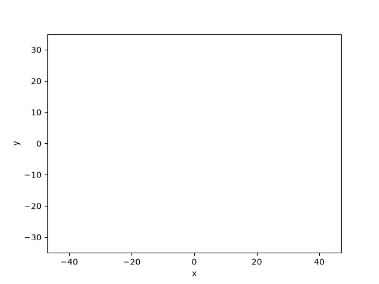
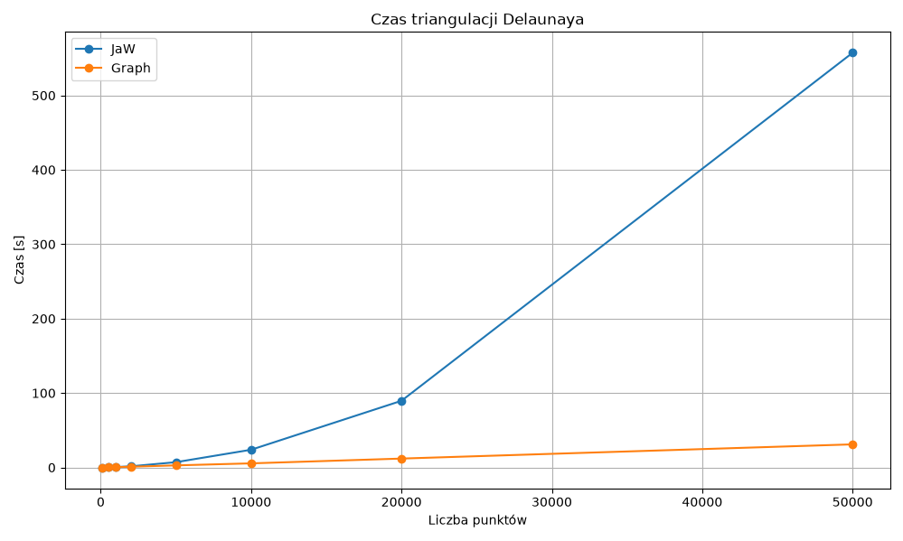
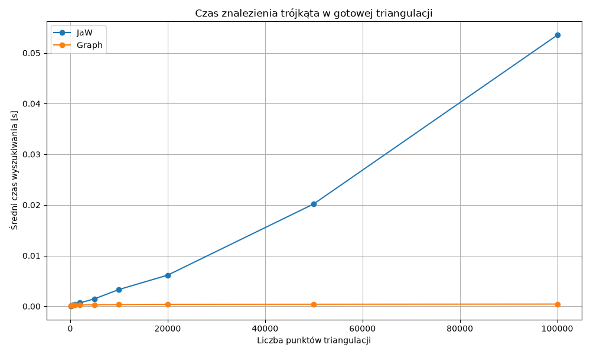

# Delaunay Triangulation



A Python implementation of Delaunay triangulation with two point-location
strategies, geometric utilities, data generators, visualization, automated
tests, and performance benchmarks. The project is structured as a complete
algorithmic workflow: from generating or importing points, through building
and querying a triangulation, to visualizing and measuring the results.

## Features

- **Delaunay triangulation** – builds a triangulation from a NumPy array of
  points with shape `(N, 2)`.
- **Point location** – supports two search strategies:
  - `JaW` – Jump and Walk,
  - `Graph` – depth-first search through the triangle children graph.
- **Geometric operations** – point orientation, edge legalization, edge flips,
  and counter-clockwise triangle construction.
- **Data generation** – includes uniform random point generation and circular
  point generation.
- **CSV input/output** – saves and loads points and triangulations.
- **Visualization** – provides an interactive visualizer and Jupyter
  notebooks for exploring the algorithm.
- **Benchmarking** – measures both triangulation construction time and point
  location time in an already constructed triangulation.

## Requirements

- Python 3.12 or newer,
- `uv` or a standard Python virtual environment,
- dependencies listed in [`pyproject.toml`](pyproject.toml).

## Installation

Clone the repository and move into the project directory:

```bash
git clone https://github.com/Szymbuk/Algorytmy-Geometryczne.git
cd Algorytmy-Geometryczne
```

Install the dependencies with `uv`:

```bash
uv sync
```

If you are already working inside an activated virtual environment, you can
install the dependencies with:

```bash
pip install -r requirements.txt
```

## Basic usage

The main triangulation class is defined in
[`Project/delaunay.py`](Project/delaunay.py).

```python
import numpy as np

from Project.delaunay import Triangulation

points = np.array([
    [0.0, 0.0],
    [4.0, 0.0],
    [4.0, 4.0],
    [0.0, 4.0],
])

triangulation = Triangulation(points, variant="JaW")
triangulation.triangulate()

triangle_id, triangle = triangulation.find_triangle(
    np.array([1.0, 1.0])
)
```

The `Graph` variant must be selected when creating the triangulation so that
the triangle children graph is built:

```python
triangulation = Triangulation(points, variant="Graph")
triangulation.triangulate()
```

## Jupyter notebooks

The demonstration notebooks are located in the `Project/` directory:

```bash
uv run jupyter notebook Project/main.ipynb
uv run jupyter notebook Project/search_demo.ipynb
```

**Visual Studio Code is the recommended environment for opening and running
the notebooks.** This project was tested with the notebooks executed through
VS Code, including its Python and Jupyter integrations.

`main.ipynb` demonstrates the triangulation process, while `search_demo.ipynb`
compares the `JaW` and `Graph` point-location strategies.

## Tests

Run the complete test suite with:

```bash
uv run pytest
```

Run only the unit tests with:

```bash
uv run pytest tests/unit
```

The tests cover point orientation, triangle location, edge operations, and
CSV input/output.

## Benchmarks

The benchmark scripts are located in [`benchmarks/`](benchmarks/):

- [`triangulation.py`](benchmarks/triangulation.py) measures triangulation
  construction time for the `JaW` and `Graph` variants;
- [`triangle_find.py`](benchmarks/triangle_find.py) measures the time required
  to find a triangle in an already constructed triangulation.

Run the benchmarks with:

```bash
uv run python -m benchmarks.triangulation
uv run python -m benchmarks.triangle_find
```

The point-location benchmark uses the centroids of active triangles as query
points. This guarantees that every query belongs to the triangulation and does
not lie on an edge.

## Benchmark results

The following charts were generated by the benchmark scripts and are stored
in the `benchmarks/` directory.

### Triangulation construction time



### Triangle search time



## Project structure

```text
Project/
├── delaunay.py                         # main triangulation implementation
├── main.ipynb                          # visualization notebook
├── search_demo.ipynb                   # point-location demonstration
├── gifs/                               # animation files
├── points/                             # sample point sets
├── triangulations/                     # sample triangulations
└── utils/
    ├── csvIO.py                        # CSV input/output
    ├── custom_types.py                 # shared type aliases
    ├── generators/                     # point generators
    ├── triangle_operations/            # geometric operations
    └── triangle_search/                # point-location strategies

bitalg/                                 # visualization toolkit
benchmarks/                             # benchmark scripts and charts
tests/                                  # unit and integration tests
```

## Project attribution

The entire `bitalg/` directory, including its visualization toolkit, was
created by the BIT Scientific Circle at AGH University of Krakow for the
Computational Geometry course. This project was developed using that toolkit
for visualization and demonstration of the Delaunay triangulation algorithm.

## License

This project is released under the MIT License.
